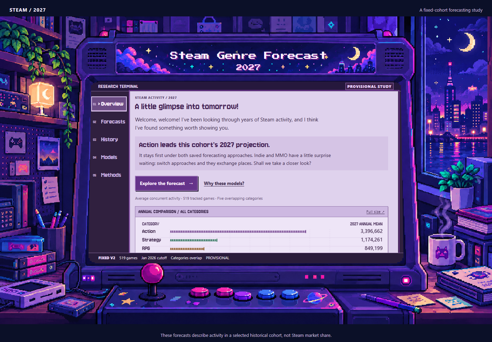
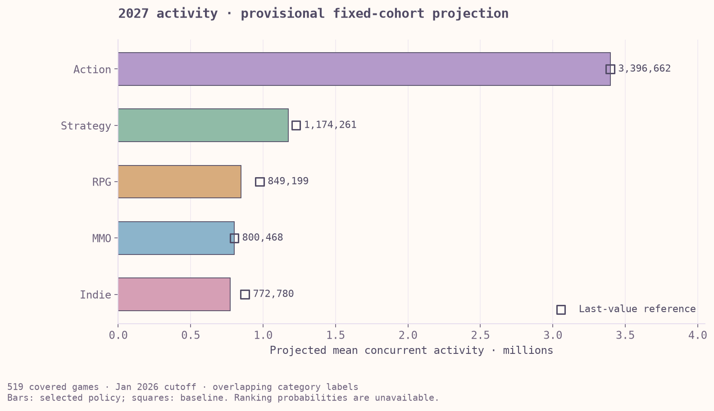

# Steam Genre Forecast 2027

**2027 average concurrent activity forecasts for a fixed cohort of 519 Steam games.**

This project combines Steam metadata and monthly activity histories to compare forecasting methods and produce a provisional category-level projection. The target is average concurrent activity, not unique monthly players, sales, revenue or the whole Steam market.

## Interactive website



Explore Overview, Forecasts, History, Models and Methods through synchronized category controls, interactive charts and automatic light/dark themes. [Preview the website locally](#run-locally). A hosted demo link will be added after deployment.

## Key findings

| Category | Selected model | Projected mean concurrent activity |
|---|---|---:|
| Action | Last value | 3,396,662 |
| Strategy | Damped seasonal | 1,174,261 |
| RPG | Damped seasonal | 849,199 |
| Massively Multiplayer | Last value | 800,468 |
| Indie | Seasonal naive | 772,780 |



The annual values average the twelve monthly predictions for 2027. Action remains largest under both the provisional policy and the last-value reference; Indie and Massively Multiplayer exchange ranks between those approaches.

The [portfolio summary](reports/PORTFOLIO_SUMMARY.md) explains the method and interpretation. Exact values are preserved in the [annual results](reports/fixed_cohort_forecast_2027/annual_summary.csv), alongside the [frozen policy](reports/fixed_cohort_forecast_2027/frozen_policy.json).

## Methods and tools

Five category series are built from games with complete 60-month histories. Last value, seasonal naive, three exponential-smoothing specifications and gradient boosting are compared using chronological 23-month forecasts. Model choice considers long-lead errors, individual cutoffs, bias and concentration before fitting through January 2026.

```text
Frozen sources → pandas preparation → SQLite category series
              → chronological model comparison → saved 2027 forecasts
              → HTML / CSS / JavaScript website
```

Python, pandas and SQLite support the research pipeline. The website uses native HTML, CSS, JavaScript and SVG charts, with no frontend build step.

## Explore the notebooks

- [Source integration and cohort definition](notebooks/17_fixed_sources_integration.ipynb)
- [Model comparison](notebooks/18_fixed_cohort_model_comparison.ipynb)
- [Error investigation](notebooks/19_fixed_cohort_error_review.ipynb)
- [2027 forecast and interpretation](notebooks/20_fixed_cohort_2027_forecast.ipynb)
- [Python forecast pipeline](src/project_fixed_cohort.py) and [SQLite schema](sql/schema_v2.sql)
- [Final technical audit](reports/FINAL_PROJECT_AUDIT.md)
- [Environment, data prerequisites and reproduction](START_HERE.md)

Verification on 27 October 2026 passed 263 non-website research tests in a fresh Windows/Python 3.14.3 environment and again against an exported staged source snapshot. This verifies the environment and synthetic test suite; it does not constitute a fresh real-data model replay. Source lineage, category aggregation and frozen output consistency were checked separately.

Raw inputs and databases remain local because source restoration and redistribution are not fully resolved. The [source notes](data/raw/README.md) distinguish recorded provenance from permission to redistribute observations.

## Project structure

```text
notebooks/   Research notebooks, including final studies 17–20
src/         Python preparation, evaluation and forecast pipelines
sql/         Database schema and analysis queries
config/      Research scope and configuration
reports/     Frozen results, evidence and technical documentation
outputs/     Saved research figures
website/     Static interactive arcade website
tests/       Automated research and website checks
docs/images/ README screenshots
```

## Run locally

From the repository root, with Python installed:

```powershell
python -m http.server 8000 --bind 127.0.0.1 --directory website
```

Open `http://127.0.0.1:8000/`. The website needs no build step. Serve it through HTTP rather than opening `index.html` directly: History loads a local JSON file. This previews the saved website without rebuilding research or requiring excluded raw inputs.

## Data and scope

| Item | Value |
|---|---:|
| Integrated archive | 7,051 games; 632,576 unique app/month records |
| Fixed modelling cohort | 519 games |
| Common history | February 2021–January 2026 |
| Category/month observations | 300 |
| Final training cutoff | January 2026 |
| Forecast horizon | 23 months, ending December 2027 |

The active dataset is `fixed_sources_v2`. The [scope config](config/project_scope.json) and [frozen source registry](reports/fixed_sources_v2/source_registry.json) record the inputs and boundaries.

## Interpretation and limitations

The January and February 2024 development origins have 36 and 37 training months. Their target-year windows overlap in 11 of 12 months. The policy is development-informed, with no untouched holdout or broad independent validation.

Category labels overlap and come from a later metadata snapshot. The fixed cohort favours consistently observed games, excludes future releases and does not represent all Steam games. Category totals must not be added as a distinct audience. Historical-error ranges are descriptive sensitivity ranges, without validated predictive coverage, annual confidence intervals or ranking probabilities.

## Public snapshot and reproduction limits

This release is a curated snapshot. Selected observation-level CSVs and a historical setup report are withheld, and four public notebook copies omit five saved output bundles containing individual-game observations. The original local research files are preserved. See [the exact exclusions, notebook changes and hash comparison](PUBLIC_SNAPSHOT.md).

The public files support reviewing the saved research and website, but do not provide a complete research replay. Before using the rebuild commands in [START_HERE.md](START_HERE.md), review the withheld prerequisites and frozen-evidence requirements in [PUBLIC_SNAPSHOT.md](PUBLIC_SNAPSHOT.md). Rebuilding is separate from previewing the website.

## Historical analysis

Notebooks 01–16 retain the original data audit, preparation, exploration, source assessment, model experiments and v1 forecasts. The v1 snapshot contains 6,729 apps and ends in September 2025. These historical results use a different population, cutoff and modelling process; differences from v2 cannot be interpreted as market growth.

- [Initial data audit](notebooks/01_understanding_the_data.ipynb)
- [Data preparation](notebooks/02_data_preparation.ipynb) and [database validation](notebooks/03_database_validation.ipynb)
- [Exploratory analysis](notebooks/04_exploratory_analysis.ipynb) and [baseline evaluation](notebooks/05_baseline_evaluation.ipynb)
- [Historical model comparison](notebooks/10_gradient_boosting.ipynb)
- [Original forecast policy](notebooks/14_forecast_policy.ipynb) and [uncertainty review](notebooks/15_forecast_uncertainty.ipynb)
- [Historical technical audit](reports/FULL_ML_AUDIT.md)

## Reuse

No repository-wide reuse license has been selected or supplied. Existing third-party terms remain separate. Bundled font license notices are retained.
