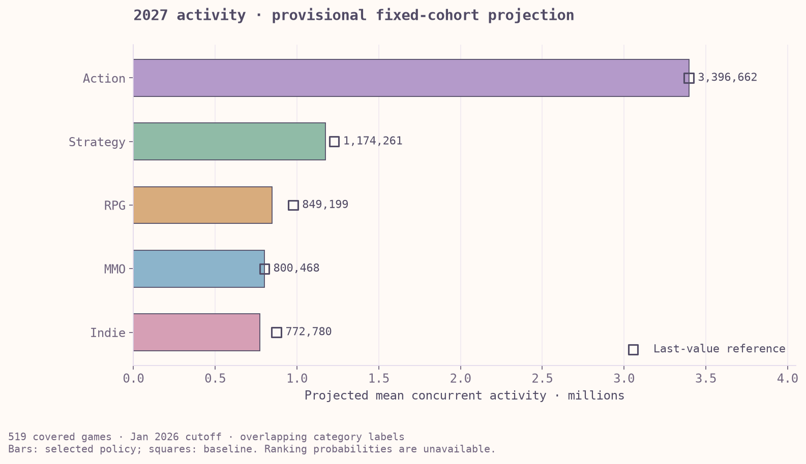

# Steam Genre Forecast — Portfolio summary

## Project question

Which Steam categories could have the most recorded player activity in 2027, within a consistently observed set of games?

This project combines data auditing, relational modelling and time-series forecasting. The final result is a reproducible projection for a fixed cohort of 519 games, supported by model comparisons, error investigations and a simple baseline reference.

## Data and scope

The integrated archive contains 632,576 unique app/month records across 7,051 apps. A smaller cohort has complete observations for all 60 months from February 2021 through January 2026 and meets the existing label-screening rule. This cohort supplies the five category series used for the final forecasts.

Popularity is measured as average concurrent activity: the average number of players active at the same time during a month. Each game's activity contributes to every selected category attached to it, so categories overlap. The result describes activity within the covered cohort rather than distinct users or the full Steam market.

## Analytical approach

1. Audited identifiers, duplicates, missing months, metadata matches and source overlap before combining records.
2. Stored games, labels, source observations and canonical monthly activity in SQLite, with recorded source priorities, relational constraints and reproducible fingerprints.
3. Fixed the modelling cohort and calendar window, retaining missing values as unknown and keeping excluded games available in the archive.
4. Compared last value, seasonal naive, three exponential-smoothing specifications and gradient boosting using chronological 23-month forecasts.
5. Reviewed long-horizon errors, individual cutoffs, bias, large misses and game concentration before recording the provisional policy.
6. Refit the chosen models through January 2026 and summarised the twelve monthly predictions for 2027 alongside a last-value reference.

The two development origins are January and February 2024, with 36 and 37 training months. Leads 12–23 match the relative position of the 2027 target year in the final forecast. The target windows overlap heavily and provide limited independent evidence.

Integration retains every source observation and uses the lowest declared source
priority for each app/month after checking agreement. A difference above 0.011
stops integration; observations are not averaged across sources and missing
activity is not converted to zero. Cohort membership requires eligible metadata,
at least one selected category and all 60 observed months. The chosen common
cutoff is January 2026 because later archive months cover fewer games. The
[source registry](fixed_sources_v2/source_registry.json) and
[cohort audit](fixed_sources_v2/cohort_audit.csv) preserve the source order,
fingerprints, licence caveats and per-game inclusion decisions.

## Results

| Category | Provisional model | Projected mean concurrent activity · 2027 |
|---|---|---:|
| Action | Last value | 3,396,662 |
| Strategy | Damped seasonal | 1,174,261 |
| RPG | Damped seasonal | 849,199 |
| Massively Multiplayer | Last value | 800,468 |
| Indie | Seasonal naive | 772,780 |

Action remains the largest category under both the provisional policy and the last-value reference. Strategy and RPG follow, while Indie and Massively Multiplayer change places between the two approaches. Their ordering is therefore sensitive to model choice.

Last value was retained for Action and MMO because the smoothing alternatives offered negligible average gains or inconsistent cutoff results. Seasonal naive improved on last value at both cutoffs for Indie. Damped seasonal smoothing led both cutoffs for RPG and Strategy, although RPG's improvement varied substantially.

[Forecast paths and historical-error sensitivity](../outputs/final_figures/forecast_paths.png) · [Final audit](FINAL_PROJECT_AUDIT.md)

## What the result supports

The project demonstrates a full analytical workflow from source validation to a versioned forecast, with attention to leakage, source lineage and model behaviour. It also shows why a simpler model can be preferable when a more complex candidate offers little stable improvement.

The main limitations are retrospective cohort selection, later-snapshot labels, a short common history and only two overlapping development folds. A few games account for a large share of category activity, while future releases and untracked games remain outside the target. Historical-error sensitivity ranges are included, with no validated predictive coverage, annual confidence interval or ranking probability. Differences between v1 and v2 forecasts combine changes in cohort, cutoff and models and cannot be read as market growth.

## Data verification and remaining limits

The read-only A002 audit on 27 October 2026 reproduced the same 519-game cohort and all 300 category/month totals. SQLite integrity and foreign-key checks passed. All five history-source fingerprints and the metadata fingerprint matched; source values agreed with the stored observations. The three v2 Parquet tables, cohort audit and source-coverage CSV also reconciled with SQLite. These checks establish consistency with the frozen local inputs, not independent accuracy of the original measurements.

The cohort contains 31,140 observed game/month records, with no missing months in its 60-month window. Of the 519 games, 296 belong to multiple selected categories, producing 957 category memberships. Category totals therefore cannot be summed as distinct games or players.

| Limitation | What can be done without changing the frozen forecast | What remains unresolved |
|---|---|---|
| Complete-history selection and source coverage | Retain the per-game audit and the separate [coverage and leader-exclusion analysis](fixed_cohort_sensitivity/README.md). | The diagnostics quantify observed-archive coverage and historical composition dependence; they do not establish Steam-wide representativeness or correct the forecast. |
| Later-snapshot category labels | State that labels are retrospective and retain the metadata fingerprint. | Historical label assignments are unavailable in the frozen inputs. A point-in-time reconstruction would need separately approved historical metadata. |
| Limited independent validation | Keep the policy provisional and distinguish development backtests from an untouched test. | Reusing development outcomes cannot create independent evidence. Any future evaluation needs a frozen scoring protocol, compatible observations and explicit missing-data rules. |
| Historical-error sensitivity ranges | Keep them labelled as uncalibrated sensitivity, without annual confidence intervals or ranking probabilities. | Calibration needs additional suitable evaluation evidence; relabelling the existing ranges cannot supply it. |
| Upstream measurement and reuse terms | Preserve local source files, hashes, URLs and the registry's licence caveats; keep raw data out of the public release. | Checksums do not validate upstream collection or grant redistribution rights. |

## Technologies and evidence

| Area | Tools and role |
|---|---|
| Data preparation | Python, pandas, NumPy and Parquet for validation, joins and monthly tables |
| Relational data | SQLite and SQL for source retention, cohort membership and independent aggregation checks |
| Models | statsmodels for exponential smoothing; scikit-learn for gradient boosting |
| Exploration | Jupyter notebooks, Matplotlib and Seaborn for reviewable analysis and historical visualisation |
| Verification | pytest, explicit validation checks and SHA-256 fingerprints |

Recommended review path:

- [Notebook 17: fixed data integration](../notebooks/17_fixed_sources_integration.ipynb)
- [Notebook 18: model comparison](../notebooks/18_fixed_cohort_model_comparison.ipynb)
- [Notebook 19: error investigation](../notebooks/19_fixed_cohort_error_review.ipynb)
- [Notebook 20: forecast and interpretation](../notebooks/20_fixed_cohort_2027_forecast.ipynb)
- [Forecast pipeline](../src/project_fixed_cohort.py), [recorded policy](fixed_cohort_forecast_2027/frozen_policy.json) and [annual results](fixed_cohort_forecast_2027/annual_summary.csv)
- [Setup and reproduction](../START_HERE.md)

Raw inputs and databases remain local; source provenance and redistribution caveats are recorded in the [fixed-source registry](fixed_sources_v2/source_registry.json).
